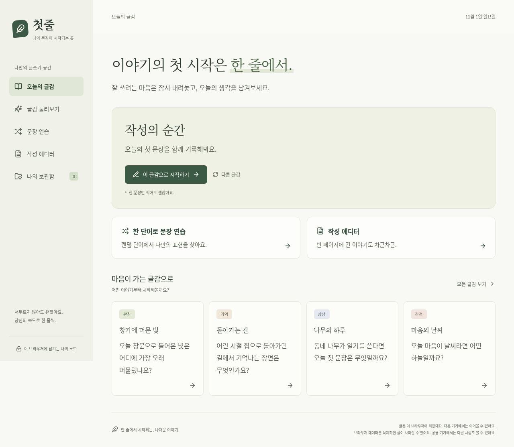

# 첫줄 · Firstline

한 문장에서 시작해, 직접 고쳐 쓰며 나만의 표현을 발견하는 글쓰기 웹앱.



## 사이트 소개 및 제작 동기

**첫줄**은 글쓰기를 시작하기 어려운 사람을 위한 한국어 개인 글쓰기 웹앱입니다. 글감을 골라 한 문장을 쓰고, 퇴고 미션에 따라 직접 고친 뒤, 처음 쓴 글과 다듬은 글을 함께 읽을 수 있습니다. 현재는 랜덤 단어로 하는 문장 연습과 여러 문서를 정리하는 작성 에디터까지 제공합니다.

이 프로젝트는 인공지능 프로그래밍 과제의 바이브 코딩 프로젝트로 시작했습니다. 제품의 출발점은 “빈 화면 앞에서 무엇을 써야 할지 모르겠다”와 “처음부터 잘 써야 한다”는 부담입니다. 완성도 높은 긴 글을 요구하기보다 한 문장으로 시작하고, 한 번에 한 가지 표현을 고치는 경험을 만들고자 했습니다. AI는 개발 과정에서 요구사항 정리와 구현·검증을 돕고, 앱 안의 글은 사용자가 직접 씁니다.

따뜻한 노트 같은 아이보리·녹색 화면, 부담을 낮추는 안내 문구, 짧은 작성 흐름을 선택한 이유도 같습니다. 문장력 점수나 순위 대신 원문·수정본·수정 이유를 보여주어 사용자가 자신의 표현을 돌아보도록 설계했습니다. 이는 제품의 목표이며, 실제 문장력 향상이 검증되었다는 의미는 아닙니다.

## 현재 제공하는 기능

- 관찰·기억·상상·감정으로 나눈 자체 작성 글감 24개와 현지 날짜별 오늘의 글감
- 한 문장부터 작성, 글자 수, 초안 자동 저장, 재방문 시 이어 쓰기
- 원문을 보존하는 퇴고 미션 8개, 미션 교체·직접 수정·건너뛰기
- 수정 전후 비교와 선택 메모, 보관함에서 직접 수정·검색·삭제 확인
- 변경됨·변경 없음·건너뜀 구분, 중복 보관 방지
- 저장 실패 재시도, 손상 데이터·지원하지 않는 형식의 덮어쓰기 방지
- 360px 모바일과 1280px 데스크톱, 키보드 조작, 대비·라벨 자동 검사
- 랜덤 단어로 문장을 쓰고 단어와 함께 보관하는 문장 연습
- 문서 목록·검색·제목·서식 도구를 갖춘 작성 에디터, 원고 자동 저장과 보관
- 폴더 생성·문서 이동, 폴더와 문서의 표시 색상 선택, TXT·Markdown·DOCX 본문 불러오기

회원가입·서버·외부 AI API·분석 추적 없이 동작합니다. 글은 해당 사이트 주소의 브라우저 localStorage에만 저장됩니다. 다른 기기나 브라우저·도메인에서는 이어볼 수 없으며, 브라우저 데이터를 삭제하면 사라질 수 있습니다. 공용 기기에서는 같은 브라우저를 쓰는 사람이 글을 볼 수 있습니다.

## PRD와 초기 버전 대비 변경점

[PRD.md](PRD.md)는 누구를 위해 무엇을 만들고, 어떤 조건에서 완료로 판단할지 정한 제품 요구사항 문서입니다. 초기 범위는 **글감 제공 → 짧은 글 작성 → 퇴고 미션 → 수정 전후 보관함**이었습니다. 한 문장 진행, 원문 보존, 자동 저장, 저장 실패 대응, 모바일·키보드 사용을 완료 조건에 포함했습니다. 로그인·서버 동기화·커뮤니티·AI 자동 첨삭은 제외했습니다.

비교 기준은 최초 PRD·TodoList가 들어간 `be564c1`과 첫 MVP 검증을 마친 `cdb06d1`입니다. 화면 정리와 문장 연습·편집기는 후속 v1.1(`9418243`), 폴더·파일 불러오기·보관함 수정은 현재 PRD v1.2에 해당합니다. 이 표의 버전은 제품 문서 버전이며 Sites 배포 버전과는 별개입니다.

| 항목 | 초기 기획·첫 MVP | 현재 구현과 바뀐 이유 | PRD 근거 |
|---|---|---|---|
| 핵심 글쓰기 | 글감에 따라 한 문장을 쓰고 미션으로 퇴고 | 기본 흐름 유지. 자체 글감 24개·미션 8개 제공 | #4, #10 |
| 홈 화면 | 오늘의 글감 제목·질문과 장식, 영문 문구, 세 걸음 안내 표시 | 주석 요청에 따라 장식·영문·단계 안내를 정리. 제목은 “이야기의 첫 시작은 한 줄에서.”, 카드 제목은 “작성의 순간”, 설명은 “오늘의 첫 문장을 함께 기록해봐요.”로 변경. 실제 글감 질문은 작성 화면에 유지 | #11, #12 |
| 글감 선택 | 오늘의 글감과 다른 글감 선택 | “다른 글감”에서 목록을 열어 선택. 홈 카드 제목이 고정되어도 어떤 글감을 고르는지 확인 가능 | #4-1, #12 |
| 문장 연습 | 별도 기능 없음 | 랜덤 단어 제시·교체, 문장 작성·복원·보관 추가. 짧은 연습을 바로 시작할 수 있음 | #11 |
| 작성 에디터 | 글감 기반 진행 중 초안 1개 | 별도로 여러 원고를 작성·검색·전환하는 서식 편집기 추가. 후속 요청에 따라 “자유 글쓰기”를 “작성 에디터”로 변경 | #11, #12 |
| 문서 정리 | 폴더와 표시 색상 없음 | 폴더 생성·이름 변경·문서 이동·접기, 폴더와 문서의 6가지 색상 선택 추가. 폴더 삭제 시 문서는 미분류로 보존 | #12 |
| 파일 불러오기 | 가져오기 범위 제외 | TXT·Markdown·DOCX의 텍스트·문단을 새 문서로 가져오는 기능 추가. 백업 복원·PDF·HWP 불러오기는 포함하지 않음 | #5-6, #12 |
| 나의 보관함 | 읽기 전용 상세와 삭제 | 글감 글·연습 문장·원고를 함께 검색하고, 상세의 “글 수정”에서 제목·본문을 수정. 퇴고 글의 수정본·메모도 수정 가능. 같은 글 ID에 저장하며 취소·저장 실패 시 기존 글 보호 | #4-4, #12 |
| 저장 구조 | `firstline.notebook.v1`에 초안·보관 글 저장 | 기존 키 유지. 문장·원고는 `firstline.studio.v1`로 분리하고, 폴더·색상 필드가 없는 이전 데이터에는 기본값 적용 | #7, #11, #12 |
| 서비스 접속 | 로컬에서 실행하는 정적 웹앱 | 기존 앱을 Sites의 본인 전용 사이트로 배포. 앱의 서버 저장·기기 간 동기화는 추가하지 않음 | #7-1 |

퇴고 진행 중의 원문 잠금은 유지합니다. 다만 **보관이 끝난 글은 사용자의 명시적인 편집으로 원문도 변경할 수 있습니다.** 초기의 읽기 전용 정책을 변경한 부분이며, 여러 시점의 수정 이력을 쌓는 기능은 없습니다. 한 개의 진행 중 초안 제한도 글감 기반 퇴고 흐름에 적용되며, 작성 에디터의 여러 원고와 구분합니다.

## SKILL.md의 내용과 사용 이유

저장소의 [SKILL.md](SKILL.md)는 `firstline-writing-mvp`라는 이름의 **프로젝트 개발 지침**입니다. PRD가 제품 요구사항, TodoList가 실행할 일과 완료 상태를 정의한다면, SKILL.md는 AI가 작업할 때 지켜야 할 순서와 판단 기준을 정의합니다. 실행 코드나 별도로 설치된 AI 모델을 뜻하지 않습니다.

이 문서를 둔 이유는 작업이 여러 단계로 이어져도 “한 문장부터 시작하고 사용자가 직접 고친다”는 목적과 저장 규칙을 일관되게 적용하기 위해서입니다. 특히 정상 화면만 만드는 것으로 끝내지 않고 저장 실패, 건너뛰기, 손상 데이터, 요구 변경까지 같은 기준으로 다루도록 했습니다.

| SKILL.md의 주요 내용 | 작업에서 적용한 방식과 근거 |
|---|---|
| PRD·TodoList를 먼저 확인하고, 확정 요구와 제안을 구분 | 초기 1~5단계 작업을 Todo 번호와 연결해 구현. 후속 요청은 PRD #11·#12와 Todo 7·8단계에 명시 |
| 한 문장 허용, 미션 교체·건너뛰기 허용, AI 채점 금지 | 공백만 막고 최소 분량은 강제하지 않음. `src/content.ts`의 정적 글감·미션과 직접 수정 흐름으로 구현 |
| 퇴고 원문 보존, 수정 없음과 건너뜀 구분 | `src/model.ts`에서 원문 스냅샷 및 `revised / unchanged / skipped` 상태 관리. 실제 텍스트 변화만 판단 |
| 저장 성공 후 완료, 실패 시 입력 유지, 중복 보관 방지 | `src/useNotebook.ts`의 저장 상태·재시도·다른 탭 충돌 감지와 모델의 ID 중복 방지에 적용 |
| 손상 데이터 보호, 사용자 글의 외부 전송 금지 | 기존 저장값을 자동 삭제하지 않고 안내. 로컬 저장·브라우저 내 파일 읽기를 사용하며 사용자 글을 분석 서비스에 보내지 않음 |
| 모바일·키보드·라벨·대비 확인, 색상 외에도 상태 표시 | 360px·1280px 브라우저 검사와 Axe 자동 검사 수행. 폴더·문서는 색상 외에 아이콘과 들여쓰기로도 구분 |
| 확인한 항목만 완료 표시, 요구 변경 시 관련 문서 갱신 | 실제 결과를 `docs/VALIDATION.md`에 기록. 보관함 재편집 요청에 맞춰 SKILL.md의 “읽기 전용” 규칙도 같은 ID에 수정 저장하는 규칙으로 갱신 |

예를 들어 “보관하기”는 버튼을 누르는 것만으로 성공 처리하지 않습니다. 저장에 실패하면 입력을 유지하고, 재시도에 성공한 뒤 초안을 비웁니다. 이런 동작은 SKILL.md의 원칙을 기능과 테스트로 구체화한 사례입니다. 이번 확장에서는 파일을 읽는 동안 작성한 내용이 덮어써지지 않는지, 보관함 편집을 취소하면 기존 글이 유지되는지도 확인했습니다.

배포에는 별도로 **Sites 스킬**의 기존 프로젝트 ID 재사용, 소스 커밋과 빌드 결과 일치, 접근 범위 유지 절차를 적용했습니다. 저장소의 SKILL.md는 제품 개발 기준이고, Sites 스킬은 호스팅 작업 절차입니다. 배포 과정은 [docs/SITES.md](docs/SITES.md)에 남겼습니다.

## TodoList 초기 버전 이후 수정·추가·삭제 사항

초기 [TodoList.md](TodoList.md)는 화면 구성, 글감·초안, 퇴고, 보관·예외, 최종 검증의 1~5단계로 구성했습니다. 아래는 단순 완료 체크 외에 기능 범위나 동작이 바뀐 부분입니다. 제거한 화면 요소와 유지한 핵심 기능을 구분해 기록했습니다.

| 구분 / 관련 Todo | 초기 내용 | 이후 변경 |
|---|---|---|
| 수정 · 1-3, 2-3 | 홈에서 글감 제목·시작 질문 표시, 다른 글감 선택 | 홈 문구를 요청한 문장으로 교체. 질문은 작성 화면에 유지하고 “다른 글감”은 목록으로 이동 |
| 삭제 · 7-1 | 첫 MVP의 영문 캡션, 꽃·카드 그림, 세 걸음 안내, 작업실 접두어 등 표시 | 화면 주석에 지정된 장식·문구·상단 아이콘 제거. 글감 데이터와 작성·퇴고 단계 자체는 유지 |
| 추가 · 6-1~6-3 | 로컬 구현과 검증까지 계획 | Sites 정적 호스팅 연결과 프로덕션 빌드 대상 재검증 추가 |
| 추가 · 7-2, 7-5~7-6 | 글감 기반 글만 작성·보관 | 랜덤 단어 문장 연습과 단어·문장 보관, 실패·복원 검사 추가 |
| 추가·이름 수정 · 7-3~7-4, 8-1 | 독립적인 다중 문서 편집기 없음 | 자유 글쓰기 편집기 추가 후 “작성 에디터”로 이름 변경. 문서 목록·검색·서식·자동 저장 제공 |
| 추가 · 8-2~8-4 | 폴더·색상·파일 불러오기 없음 | 폴더 관리, 문서 이동, 색상 선택, TXT·Markdown·DOCX 불러오기와 실패 재시도 추가 |
| 수정 · 4-7, 8-5~8-6 | 보관 상세를 읽기 전용으로 제공 | 상세에서 글 수정·저장·취소 허용. 같은 ID 유지, 수정 시각 기록, 퇴고 상태 재계산 |
| 범위 조정 · 제외-4·6·7 | 장편 관리, 가져오기, 보관 글 재편집 제외 | 문서 관리·본문 가져오기·보관 글 재편집을 사용자 요청 범위에 포함. 세계관·캐릭터·플롯, 백업 복원, 다중 수정 이력은 계속 제외 |
| 검증 확대 · 7-7, 8-6~8-7 | 단위 8개·브라우저 34개 검사 | 단위 16개·브라우저 66개 검사로 확대. 이전 저장 구조 호환, 폴더 삭제 시 문서 보존, 비동기 가져오기, 편집 취소·실패 검사 추가 |

초기 핵심 기능인 글감·퇴고 미션·전후 비교는 삭제하지 않았습니다. 제거한 것은 주석으로 지정된 화면 요소와 보관함의 읽기 전용 제한이며, 서버 동기화·공개 게시·AI 자동 첨삭은 현재도 제외 범위입니다.

## 느낀 점 및 결론

이번 작업에서 얻은 가장 큰 교훈은 AI와 개발할 때도 **원하는 결과와 완료 기준을 구체적으로 정해야 한다**는 점입니다. “글쓰기 사이트를 만든다”는 요청을 PRD의 사용자 흐름, TodoList의 작업 단위, SKILL.md의 저장·검증 규칙으로 나누자 구현 결과를 확인하고 수정할 기준이 생겼습니다.

작은 기능 변경도 기존 동작과 연결되어 있다는 점을 확인했습니다. 보관함을 수정 가능하게 바꾸면서 읽기 전용 문구와 테스트를 함께 바꿔야 했고, 폴더 삭제는 내부 문서의 보존 방식을 정해야 했습니다. 파일 불러오기는 읽는 동안 사용자가 작성한 내용을 보호해야 했습니다. 화면에 버튼을 추가하는 것만으로 기능이 완성되는 것은 아니었습니다.

화면 주석으로 불필요한 장식과 문구를 줄이고, 이어서 문서 정리와 재편집을 추가하면서 처음 계획한 짧은 연습 도구가 개인 작성 공간으로 확장되었습니다. 이 과정에서는 기능을 늘리는 것만큼 기존 글을 잃지 않게 하고, 바뀐 요구를 문서에 남기는 일이 중요했습니다.

현재 첫줄은 글감으로 시작해 직접 퇴고하고, 문장·원고를 정리하며 다시 수정할 수 있는 개인 글쓰기 웹앱입니다. 구현과 자동 검증은 완료했지만 초보자 대상 사용성 조사와 실제 모바일 한글 입력 환경 검증은 남아 있습니다. 다음 개선의 기준은 기능 수보다 사용자가 첫 문장을 쉽게 시작하고 자신의 표현을 돌아볼 수 있는지에 두고자 합니다.

## 실행

Node.js 22 이상 권장(검증 환경: Node.js 24.19.0, npm 11.9.0).

```bash
npm ci
npm run dev
```

첫줄은 React 19 + TypeScript + Vite로 구성한 클라이언트 웹앱입니다. 환경 변수나 API 키는 필요하지 않습니다.

```bash
npm run build       # TypeScript 검사 + dist/ 프로덕션 빌드
npm run preview     # 빌드 결과를 로컬에서 확인
npm test            # 기존 글과 새 편집기의 저장·보관 모델 검사
npm run test:e2e    # 모바일·데스크톱 기능·예외·접근성 검사
```

클라우드 환경에는 `/usr/bin/chromium`이 준비되어 있습니다. 다른 개발 환경에서는 Chromium을 설치하고 실행 파일 경로를 지정하세요.

```bash
CHROMIUM_PATH=/path/to/chromium npm run test:e2e
```

Playwright는 필요할 때 개발 서버를 자동으로 시작합니다. 테스트는 별도 브라우저 컨텍스트를 사용하며 실제 사용자 글을 읽거나 변경하지 않습니다. 화면 캡처는 `test-results/`에 생성됩니다.

## 구성

- `src/content.ts`: 글감·미션과 기기 현지 날짜별 글감 선택
- `src/model.ts`: 버전 1 저장 구조, 원문 스냅샷, 보관 상태와 유효성 검사
- `src/useNotebook.ts`: 지연 자동 저장, 새로고침 직전 저장, 저장 실패·다른 탭 충돌 보호
- `src/studioModel.ts`: 랜덤 단어, 원고, 새 보관 글의 독립 저장 구조와 유효성 검사
- `src/Studio.tsx`: 문장 연습과 Tiptap 기반 작성 에디터
- `src/DocumentSidebar.tsx`: 폴더·문서 목록, 색상 설정과 파일 선택
- `src/importDocument.ts`: TXT·Markdown·DOCX의 브라우저 내 텍스트 추출
- `src/EntryEditor.tsx`: 보관 글 편집·취소·저장 실패 처리
- `src/organization.css`: 폴더 목록과 보관 글 편집 창의 반응형 스타일
- `src/studio.css`: 단순해진 홈과 반응형 원고 편집기
- `src/App.tsx`: 홈 → 작성 → 퇴고 → 전후 비교 → 보관함
- `src/styles.css`: 반응형 디자인과 키보드 초점 표시
- `src/model.test.ts`, `tests/`: 기능·예외·접근성 검증

## 구현 기록

- [제품 요구사항](PRD.md)
- [완료 체크리스트](TodoList.md)
- [프로젝트 개발 지침](SKILL.md)
- [검증 절차와 실제 결과](docs/VALIDATION.md)
- [모바일 화면](docs/images/home-mobile.png)

초기 구현은 실행 환경, 콘텐츠·모델, 작성·퇴고, 보관·예외 처리, 최종 검증 문서 단위로 커밋했습니다. Sites 후속 작업은 같은 저장소의 `sites/firstline` 작업 트리에서 이어갑니다. 로컬 커밋, Sites 소스 반영, GitHub 원격 반영은 별개의 작업입니다.

## Sites

[첫줄 사이트](https://firstline-writing-cw.iuci7521.chatgpt.site) · [배포 설정과 검증 기록](docs/SITES.md)

`.openai/hosting.json`에 연결된 Sites ID와 정적 출력 경로 `dist`를 기록합니다. Sites는 본인 전용이며, 접속 시 ChatGPT 인증이 필요할 수 있습니다. 앱 자체의 별도 회원가입이나 서버 저장은 없습니다.

로컬 개발 주소에서 작성한 글은 Sites 주소로 자동 이전되지 않습니다. 브라우저 저장소는 주소마다 분리됩니다. 실제 사용자 대상 사용성 검증은 별도 진행이 필요합니다.

기존 글감·퇴고 데이터의 저장 키는 유지합니다. 원고와 연습 문장은 `firstline.studio.v1`에 저장하며, 세 종류의 보관 글을 ‘나의 보관함’에서 함께 읽고 수정할 수 있습니다. 원고의 서식은 자동 저장되며, 완성한 글을 보관할 때는 본문만 옮긴다는 안내를 표시합니다.

파일 불러오기는 브라우저에서만 처리하며 원본 파일을 바꾸거나 서버로 보내지 않습니다. TXT·Markdown·Word(DOCX)를 파일당 5MB, 본문 20만 자까지 지원하고, 서식·이미지를 제외한 텍스트와 문단을 가져옵니다. PDF·HWP 불러오기는 지원하지 않습니다.
